<p align="center">
  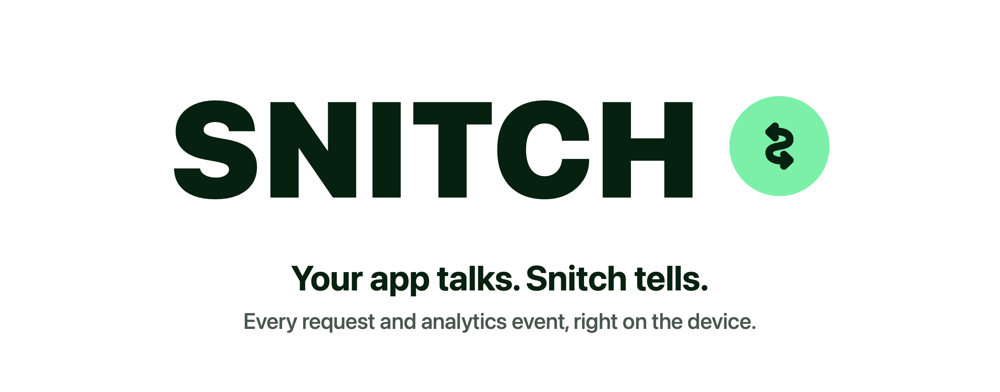
</p>

<p align="center">
  <a href="https://github.com/BachoOnn/snitch/tags"></a>
  
  
  <a href="https://github.com/BachoOnn/snitch/blob/main/LICENSE"></a>
</p>

See what your iOS app sends and logs: network requests and analytics events, each on its own screen in one inspector.

> **Status:** early development. The network inspector, PostHog events and AppsFlyer events work; the API may still change.

### Overview

<table>
<tr>
<td align="center" width="33%">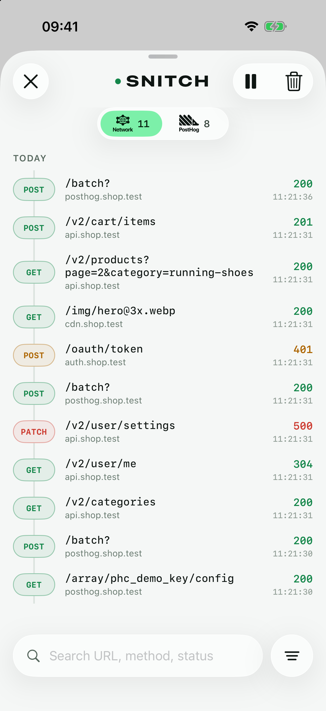<br><sub>Network (v1)</sub></td>
<td align="center" width="33%">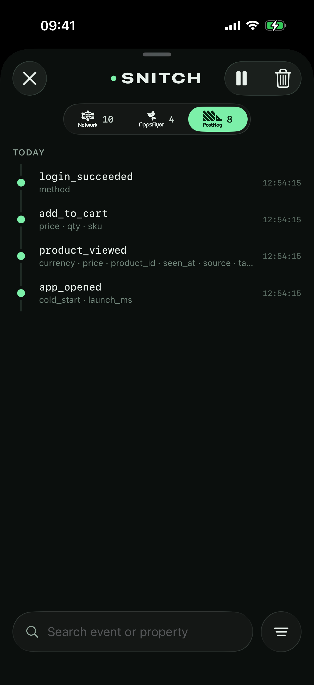<br><sub>PostHog (v2)</sub></td>
<td align="center" width="33%">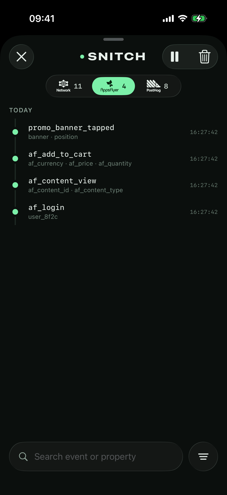<br><sub>AppsFlyer (v3)</sub></td>
</tr>
<tr>
<td align="center" width="33%">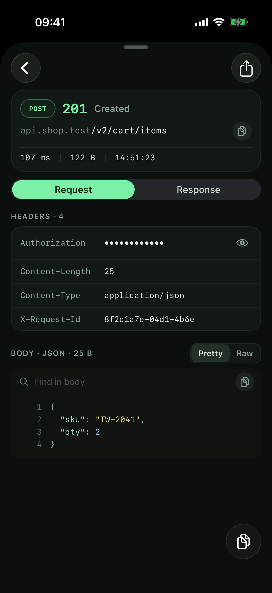<br><sub>Request detail</sub></td>
<td align="center" width="33%">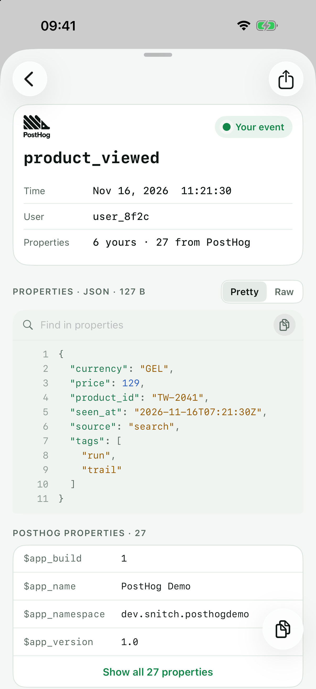<br><sub>PostHog event</sub></td>
<td align="center" width="33%">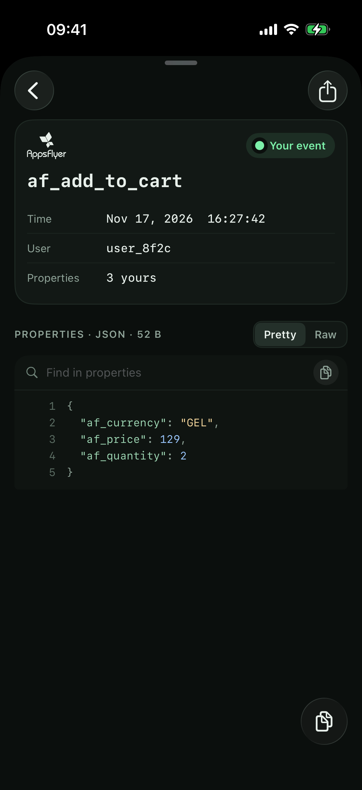<br><sub>AppsFlyer event</sub></td>
</tr>
</table>

### See it in action

<table>
<tr>
<td valign="top" width="33%"><p align="center">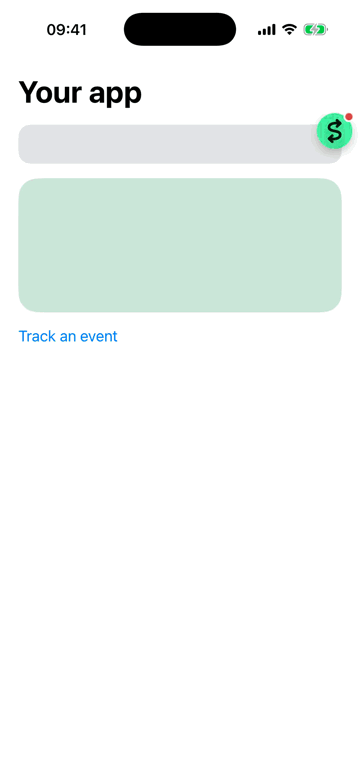</p><sub><b>Find requests</b><br>Search, filters, hidden headers, pretty or raw bodies, find in body</sub></td>
<td valign="top" width="33%"><p align="center">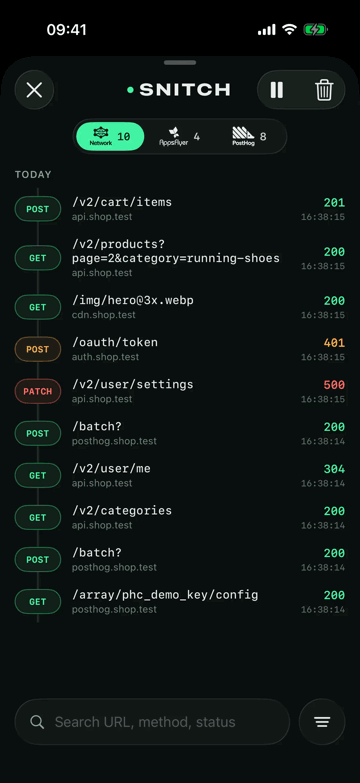</p><sub><b>Copy and share</b><br>Long press to copy, a copy button you can drag, cURL</sub></td>
<td valign="top" width="33%"><p align="center">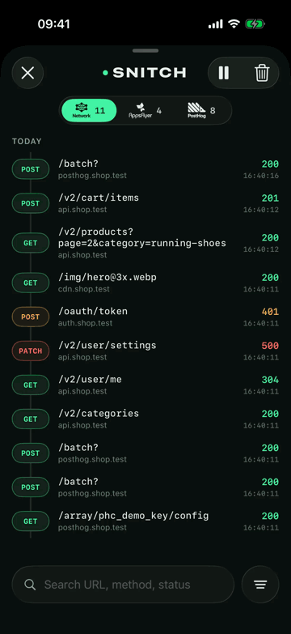</p><sub><b>Follow events</b><br>Swipe between screens, open an event's upload and its other events</sub></td>
</tr>
<tr>
<td valign="top"><p align="center">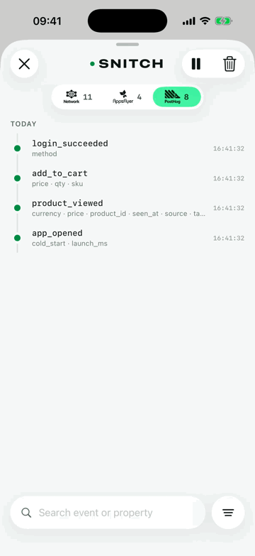</p><sub><b>Pause and clear</b><br>Paused time shows as a gap; clearing leaves your app alone</sub></td>
<td valign="top"><p align="center">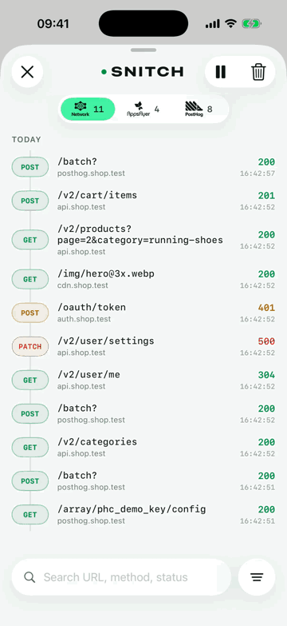</p><sub><b>Light and dark</b><br>Follows the device's appearance</sub></td>
<td valign="top"><p align="center">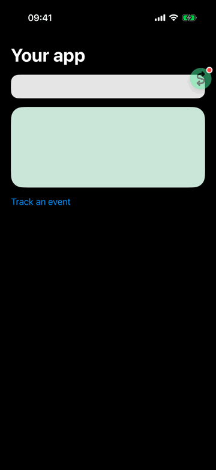</p><sub><b>Floating button</b><br>Drag it anywhere; a red dot means new failed requests. Tap to open, or shake</sub></td>
</tr>
</table>

## What it is

Snitch is an in-app debugging tool for iOS. It records your app's own `URLSession` traffic and, with optional adapters, the analytics events your app emits (PostHog and AppsFlyer). Each shows up on its own screen in a single SwiftUI inspector.

## What it is not

- **Not a proxy.** Snitch does not intercept or decrypt traffic on the network and does not break TLS. It observes requests made by your own app, from inside your app.
- **Not for production.** It is built for debug builds and is designed to be easy to exclude from release builds.
- **No telemetry.** Nothing leaves the device. Snitch does not phone home.

## Features

**v1: network inspector**
- Request and response capture via `URLProtocol`, kept in memory only
- A timeline of every request, newest first, with search and filters for status, method and host
- Request and response detail with headers, pretty or raw JSON bodies and find-in-body
- Sensitive headers such as `Authorization` and `Cookie` hidden until you tap to reveal them
- Copy a one-line summary, a body, or the whole request as cURL
- Pause recording, with the paused gaps marked on the timeline
- A small floating button and shake-to-open, both optional
- Native Liquid Glass on iOS 26, with a material fallback on iOS 16 to 25

**v2: PostHog events**
- An optional `SnitchPostHog` product that shows every event your app sends to PostHog
- A screen per logger: switch between Network and PostHog under the title, or swipe sideways
- PostHog's own events (`$screen`, `$identify`, app lifecycle) hidden until you turn them on in the filters
- Event properties in the same Pretty/Raw JSON view as request bodies, with PostHog's own properties listed apart
- Each event links to the upload that sent it, and each upload lists its events, with its gzip body unzipped
- Pauses marked on the PostHog timeline too

**v3: AppsFlyer events**
- An optional `SnitchAppsFlyer` product that shows every in-app event your app logs to AppsFlyer
- One line to set up: your app's own AppsFlyer calls stay as they are

## Planned

- HAR export
- Header and body redaction

## Installation

Swift Package Manager:

```swift
.package(url: "https://github.com/BachoOnn/snitch", from: "3.1.1")
```

### Choosing a version

Each major version adds one logger. Pick the one that covers the SDKs your app uses:

| Version | Screens | Also downloads | Install |
|---|---|---|---|
| 1.x | Network | Nothing | `from: "1.1.2"` |
| 2.x | Network, PostHog | PostHog | `from: "2.1.1"` |
| 3.x | Network, PostHog, AppsFlyer | PostHog | `from: "3.1.1"` |

`from:` stays within that major version, so you get its fixes but never the next
logger's SDK. Swift Package Manager downloads every SDK a version depends on, even
for products you don't add, so an app without PostHog can stay on 1.x and download
nothing else. PostHog is only built into apps that add `SnitchPostHog`.

`SnitchAppsFlyer` doesn't depend on AppsFlyer, so it adds nothing to download. From
3.1.0 it uses the AppsFlyer already in your app; 3.0.0 downloaded it.

## Quick start

Start Snitch as early as possible, for example in your app's `init`:

```swift
import Snitch

@main
struct MyApp: App {
    init() {
        Snitch.start()
    }
    // ...
}
```

Tap the floating button or shake the device to open the inspector. In builds without
`DEBUG`, every Snitch call does nothing.

`Snitch.start()` covers `URLSession.shared`. For your own sessions, add Snitch to the
configuration before creating the session:

```swift
let configuration = URLSessionConfiguration.default
Snitch.install(in: configuration)
let session = URLSession(configuration: configuration)
```

Requests from that session keep its own settings while Snitch records: its cookie
store and cookie rules, cache, credentials and network policies. Certificate checks
and login challenges still go to your session's delegate, so SSL pinning and custom
trust handling keep working.

If the code that builds the session takes a list of protocol classes instead, pass
`Snitch.urlProtocolClasses` (it is empty in builds without `DEBUG`). Requests captured
this way use default settings, so cookies go to the shared cookie store; prefer
`install(in:)` where you can.

### Leaving out third-party traffic

Third-party SDKs often use `URLSession.shared` too, so their requests show up
alongside yours. To skip some hosts, list them. Each one also covers its subdomains,
and skipped requests are never touched by Snitch:

```swift
Snitch.ignoredHosts = ["ads.example.com"]
```

To record only your own sessions, leave `URLSession.shared` out and add your sessions
with `install(in:)` or `urlProtocolClasses`:

```swift
Snitch.start(capturesSharedSession: false)
```

### PostHog events

Add the `SnitchPostHog` product to your app target (it needs PostHog for iOS 3.28 or
later), then add Snitch's hook to your PostHog configuration:

```swift
import SnitchPostHog

config.setBeforeSend(SnitchPostHog.beforeSend)
PostHogSDK.shared.setup(config)
```

Once the hook is set, a PostHog screen and a switcher between it and Network appear
in the inspector, with each event and its properties as the app captured them.
`Snitch.start()` alone shows only the Network screen. The hook returns events unchanged. If you already use `beforeSend`
blocks to change or drop events, put Snitch's last so it shows what is actually sent:

```swift
config.setBeforeSend(myRedaction, SnitchPostHog.beforeSend)
```

To also see PostHog's uploads on the Network screen, and link each event to the
upload that sent it, give PostHog a session configuration with Snitch installed:

```swift
let session = URLSessionConfiguration.default
Snitch.install(in: session)
config.urlSessionConfiguration = session
```

PostHog's automatic screen views of Snitch's own screens, such as its floating button
or the open inspector, are dropped so Snitch doesn't add to your analytics. Session
replay frames are never shown.

#### PostHog versions

`SnitchPostHog` accepts any PostHog for iOS from 3.28 up to, but not including, 4.0.
Swift Package Manager picks one PostHog version for the whole app, so Snitch uses
whichever version your app already has in that range and never changes it:

- **3.28 to 3.x:** works with your current version.
- **Older than 3.28:** package resolution fails. Update PostHog; 3.28 added the
  `beforeSend` hook Snitch relies on.
- **4.0 or later:** not supported until a Snitch release adds it.

Swift Package Manager downloads PostHog when you add Snitch, even if you only use the
`Snitch` product. It is only built into apps that add `SnitchPostHog`.

### AppsFlyer events

Add the `SnitchAppsFlyer` product to your app target (your app needs AppsFlyer for iOS
6.1 or later), then start it next to Snitch:

```swift
import SnitchAppsFlyer

Snitch.start()
SnitchAppsFlyer.start()
```

That's all: the code that logs your events doesn't change. An AppsFlyer screen and a
switcher appear in the inspector, with each event and its values as the app logged them.

AppsFlyer has no hook that sees events before they are sent, so in `DEBUG` builds Snitch
wraps AppsFlyer's two public `logEvent` methods. Each call is recorded, then passed on to
AppsFlyer unchanged. In other builds `start()` does nothing and AppsFlyer is untouched.

What it shows and doesn't:

- **Shown:** every event logged through `logEvent`, from your code or from a wrapper or
  plugin that calls it.
- **Not shown:** what AppsFlyer sends on its own, such as installs and app opens.
- **No uploads on the Network screen:** AppsFlyer encrypts its requests and sends them
  through its own `URLSession`, so they can't be shown or linked to their events.

`SnitchAppsFlyer` doesn't depend on AppsFlyer. It finds AppsFlyer by name while your app
runs, so it works with whichever version your app already has and adds nothing to
download. Before wrapping a method, it checks that the method exists and takes the
arguments it expects; if not, it leaves that method alone. In an app without AppsFlyer,
the screen still appears and stays empty.

### Other options

```swift
Snitch.start(showsButton: false, opensOnShake: true) // choose how the inspector opens
Snitch.present()                                       // open it from your own debug menu
Snitch.pause()                                         // stop recording until resume()
Snitch.resume()
```

## Requirements

iOS 16+, Swift 5.9+

Running the tests requires Xcode 16+ (Swift 6 toolchain) for Swift Testing.

## Security

See [SECURITY.md](SECURITY.md).

## License

Apache 2.0. See [LICENSE](LICENSE).

PostHog and the PostHog logo are trademarks of PostHog, Inc. `SnitchPostHog` shows the
unmodified logo only to label PostHog's screen. Snitch isn't made or endorsed by PostHog.

AppsFlyer and the AppsFlyer logo are trademarks of AppsFlyer Ltd. `SnitchAppsFlyer` shows the
logo in one color, with the mark above the wordmark, only to label AppsFlyer's screen.
Snitch isn't made or endorsed by AppsFlyer.
