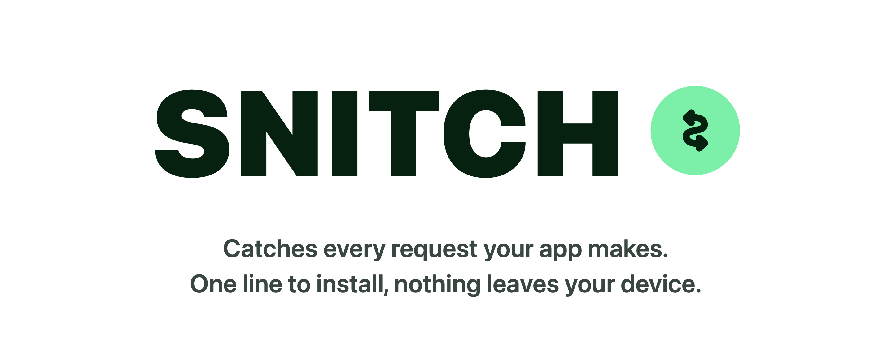
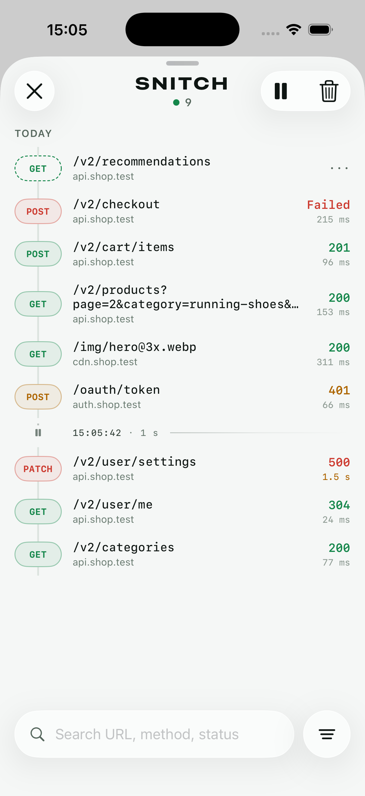
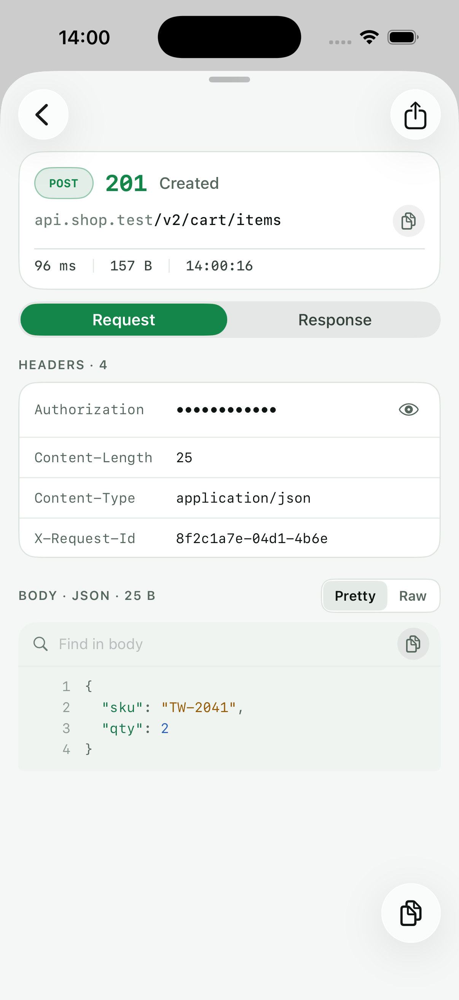

<p align="center">
  
</p>

<p align="center">
  <a href="https://github.com/BachoOnn/snitch/tags"></a>
  
  
  <a href="https://github.com/BachoOnn/snitch/blob/main/LICENSE"></a>
</p>

See what your iOS app sends and logs: network requests and analytics events, side by side, in one timeline.

> **Status:** early development. The network inspector (v1) works; the API may still change before 1.0.

### Overview

<table>
<tr>
<td align="center"><br><sub>Timeline</sub></td>
<td align="center"><br><sub>Request detail</sub></td>
</tr>
</table>

## What it is

Snitch is an in-app debugging tool for iOS. It records your app's own `URLSession` traffic and, with optional adapters, the analytics events your app emits (PostHog, AppsFlyer). Both show up in a single SwiftUI inspector.

## What it is not

- **Not a proxy.** Snitch does not intercept or decrypt traffic on the network and does not break TLS. It observes requests made by your own app, from inside your app.
- **Not for production.** It is built for debug builds and is designed to be easy to exclude from release builds.
- **No telemetry.** Nothing leaves the device. Snitch does not phone home.

## Features

**v1: network inspector**
- Request and response capture via `URLProtocol`, kept in memory only
- A timeline of every request, newest first, with search and filters for status, method and host
- Request and response detail with headers, pretty or raw JSON bodies and find-in-body
- Sensitive headers such as `Authorization` and `Cookie` hidden until you tap to reveal them
- Copy a one-line summary, a body, or the whole request as cURL
- Pause recording, with the paused gaps marked on the timeline
- A small floating button and shake-to-open, both optional
- Native Liquid Glass on iOS 26, with a material fallback on iOS 16 to 25

## Planned

**v1.1: analytics timeline**
- Optional adapters as separate products: `SnitchPostHog`, `SnitchAppsFlyer`
- Network calls and analytics events in one timeline, filterable by source

**v1.2**
- HAR export
- Header and body redaction
- Labeling of batched analytics requests

## Installation

Swift Package Manager:

```swift
.package(url: "https://github.com/BachoOnn/snitch", from: "1.1.1")
```

## Quick start

Start Snitch as early as possible, for example in your app's `init`:

```swift
import Snitch

@main
struct MyApp: App {
    init() {
        Snitch.start()
    }
    // ...
}
```

Tap the floating button or shake the device to open the inspector. In builds without
`DEBUG`, every Snitch call does nothing.

`Snitch.start()` covers `URLSession.shared`. For your own sessions, add Snitch to the
configuration before creating the session:

```swift
let configuration = URLSessionConfiguration.default
Snitch.install(in: configuration)
let session = URLSession(configuration: configuration)
```

Requests from that session keep its own settings while Snitch records: its cookie
store and cookie rules, cache, credentials and network policies. Certificate checks
and login challenges still go to your session's delegate, so SSL pinning and custom
trust handling keep working.

If the code that builds the session takes a list of protocol classes instead, pass
`Snitch.urlProtocolClasses` (it is empty in builds without `DEBUG`). Requests captured
this way use default settings, so cookies go to the shared cookie store; prefer
`install(in:)` where you can.

### Leaving out third-party traffic

SDKs such as AppsFlyer often use `URLSession.shared` too, so their requests show up
alongside yours. To skip some hosts, list them. Each one also covers its subdomains,
and skipped requests are never touched by Snitch:

```swift
Snitch.ignoredHosts = ["appsflyersdk.com"]
```

To record only your own sessions, leave `URLSession.shared` out and add your sessions
with `install(in:)` or `urlProtocolClasses`:

```swift
Snitch.start(capturesSharedSession: false)
```

Other options:

```swift
Snitch.start(showsButton: false, opensOnShake: true) // choose how the inspector opens
Snitch.present()                                       // open it from your own debug menu
Snitch.pause()                                         // stop recording until resume()
Snitch.resume()
```

## Requirements

iOS 16+, Swift 5.9+

Running the tests requires Xcode 16+ (Swift 6 toolchain) for Swift Testing.

## Security

See [SECURITY.md](SECURITY.md).

## License

Apache 2.0. See [LICENSE](LICENSE).
